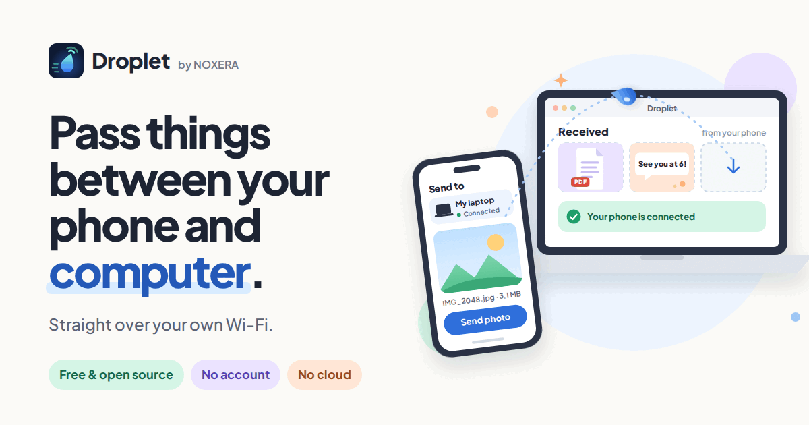
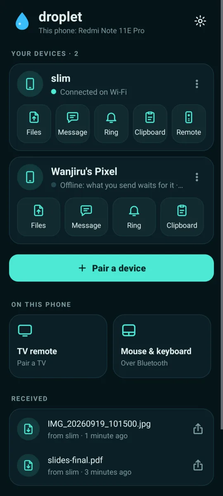
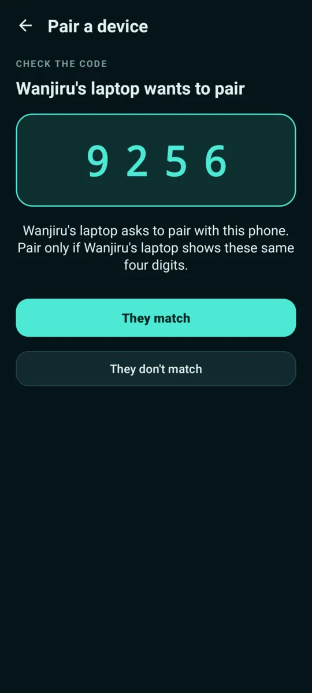
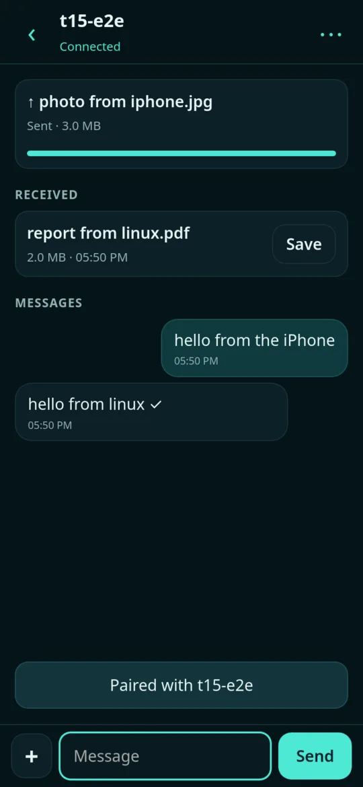
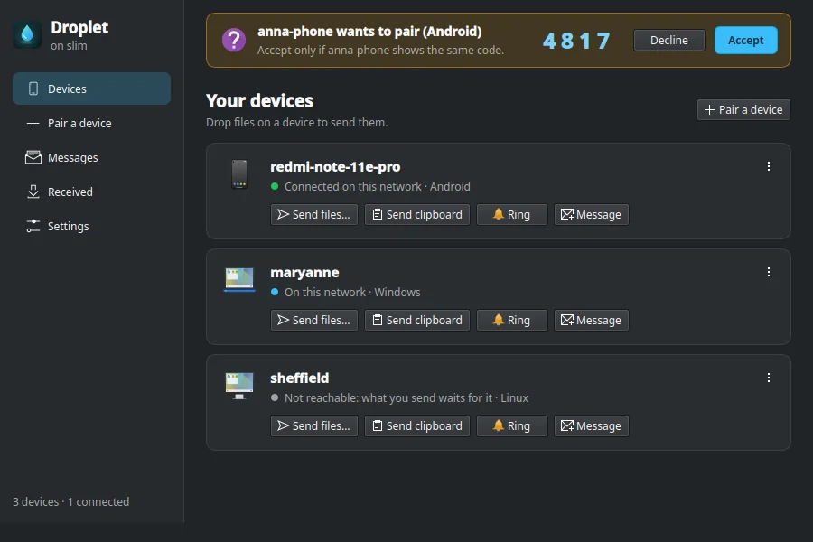

# NOXERA Droplet

**Send files, links, messages and your clipboard between your phone and your computers.** 
Straight over your own Wi-Fi or a phone's hotspot. No account, no cloud, nothing in the middle.

  

[**Website**](https://droplet.noxeratech.com) &nbsp;·&nbsp; [**Download**](#get-it) &nbsp;·&nbsp; [**How it works**](#how-it-works) &nbsp;·&nbsp; [**Full guide**](docs/guide.md)

 

## What it does

<table>
<tr>
<td width="50%" valign="top">

### Send any file
Photos, videos, PDFs, anything, at full quality and any size. Watch it go with a progress bar, and cancel it from either side.

</td>
<td width="50%" valign="top">

### Links and messages
Send a link and it opens on your other device. Or just type a quick message, like a chat with yourself.

</td>
</tr>
<tr>
<td valign="top">

### One clipboard
Copy on your phone, paste on your computer, and the other way round.

</td>
<td valign="top">

### Ring a lost phone
Make your phone ring loudly from your computer, even when it's on silent.

</td>
</tr>
<tr>
<td valign="top">

### No Wi-Fi? Use a hotspot
Turn on your phone's hotspot and Droplet still works, without using any of your mobile data.

</td>
<td valign="top">

### Your devices and your friends'
Pair a friend's phone too. They can send you files and messages, but never see your clipboard or notifications.

</td>
</tr>
<tr>
<td valign="top">

### Several devices at once
Tick a few devices, or **All my devices**, and send to all of them in one go.

</td>
<td valign="top">

### Your phone as a remote
Use your phone as a touchpad, keyboard or media remote for your computer.

</td>
</tr>
</table>

 

## Screenshots

&nbsp;
&nbsp;

  

 

## Get it

| Device | How to install |
|---|---|
| **Android** 8 or newer | [Download the app](https://droplet.noxeratech.com/android) and open it. Your phone asks once to allow installs from your browser. |
| **iPhone** | In Safari, open [droplet.noxeratech.com/app](https://droplet.noxeratech.com/app), tap **Share** → **Add to Home Screen**. Nothing to install from the App Store. |
| **Windows** 10 or 11 | Get **NOXERA Droplet** from the [Microsoft Store](https://apps.microsoft.com/detail/9N8VX22MW0N4). |
| **Mac** | Open Terminal and paste: `curl -fsSL https://droplet.noxeratech.com/mac.sh \| sh` |
| **Linux** | Open a terminal and paste: `curl -fsSL https://droplet.noxeratech.com/linux.sh \| sh` |

Every download is also on the [releases page](https://github.com/Ferinmtk/droplet/releases/latest), with its checksum.

 

## How it works

<table>
<tr>
<td align="center" width="33%"><h3>1</h3><b>Install</b> Put Droplet on two devices.</td>
<td align="center" width="33%"><h3>2</h3><b>Pair once</b> Tap <b>Pair</b> on both. They show the same four digits; check they match.</td>
<td align="center" width="33%"><h3>3</h3><b>Share</b> From now on they find each other by themselves, whenever they're on the same Wi-Fi or hotspot.</td>
</tr>
</table>

 

## Private by design

- **Nothing goes through the internet.** Your devices talk straight to each other on your own network.
- **No account and no sign-up.** There's no server of ours that sees your files.
- **Only paired devices can connect,** and everything between them is encrypted.
- **No ads, no tracking.** Droplet is free and open source, so anyone can check how it works.
- **You're in control.** Every device has switches for what it may do, and you can pause any device, or all of them, at any time.

 

## For developers

Droplet is a set of native apps that speak the same open protocol, so any device can pair with any other.

| Part | Built with | Read more |
|---|---|---|
| Android app | Kotlin | [android/](android/README.md) |
| Windows app | C# / .NET | [windows-net/](windows-net/README.md) |
| Mac and Linux | Python | [agent/](agent/README.md) |
| iPhone | Web app (WebRTC) | [docs/iphone.md](docs/iphone.md) |
| How devices find, pair and talk | | [docs/mesh.md](docs/mesh.md) |
| Everything else, in detail | | [docs/guide.md](docs/guide.md) |

Found a bug or have an idea? [Open an issue](https://github.com/Ferinmtk/droplet/issues).

 

Made in Nairobi by **[NOXERA](https://droplet.noxeratech.com)** · Free software under the [GPL-3.0](LICENSE)

